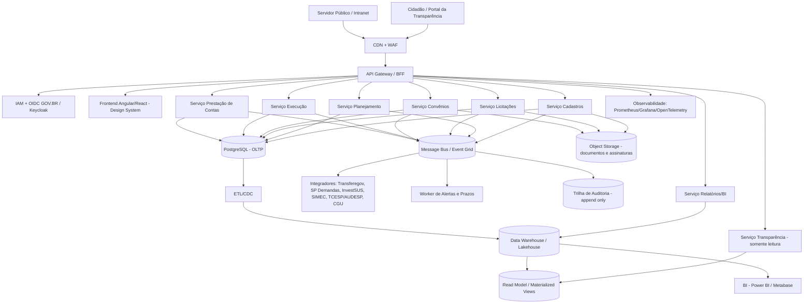

# SIG v2.0 — Arquitetura de Nuvem e Plano de Escalabilidade
**Prefeitura Municipal da Estância Turística de Paraguaçu Paulista/SP**

> Versão 2.0: futura implantação em nuvem. A v1.0 permanece como protótipo funcional e referência de requisitos.

---

## 1. Princípios arquiteturais

1. **API-first:** contratos OpenAPI antes de interfaces; o Portal da Transparência é apenas um consumidor.
2. **Domínio dividido por bounded contexts:** Cadastros, Planejamento, Licitações, Convênios, Execução, Prestação de Contas, Transparência, BI.
3. **Event-driven:** mudanças de estado publicam eventos (contrato assinado, repasse realizado, prazo vencido) para integrações e watchdogs.
4. **Segurança por padrão:** OIDC/GOV.BR, RBAC+ABAC, trilha append-only, criptografia em repouso e em trânsito, LGPD by design.
5. **Escalabilidade horizontal:** serviços stateless, filas, cache, storage de objetos e warehouse separado.
6. **Observabilidade:** métricas, logs estruturados e tracing distribuído desde o dia 1.

---

## 2. Diagrama de alto nível



---

## 3. Componentes

### 3.1 Frontend
- SPA em **React ou Angular** com o mesmo design system (azul `#1e3a8a`, verde `#15803d`).
- BFF (Backend for Frontend) para agregar chamadas e reduzir payloads.
- Suporte offline parcial para formulários via service worker e fila de sincronização.
- Acessibilidade e-MAG mantida; tema claro/alto contraste; componentes validados com axe-core.

### 3.2 Gateway e identidade
- **API Gateway** com rate limiting, CORS controlado, WAF e mTLS interno.
- **OIDC/OAuth 2.0** com login GOV.BR (quando disponível) ou IdP institucional (Keycloak).
- Perfis: Administrador, Controle Interno, Gestor/Fiscal, Operador, Cidadão (somente leitura).
- **ABAC** adicional: secretaria do usuário + tipo de instrumento + fase do fluxo.

### 3.3 Serviços de domínio

| Serviço | Responsabilidades |
|---|---|
| `cadastros-api` | Secretarias, fundos, autarquias, servidores, fornecedores, OSCs, perfis |
| `planejamento-api` | DFD, PCA, ETP, pesquisas, matriz de riscos, TR, projeto básico |
| `licitacoes-api` | Processos, editais, contratação direta, ARP, contratos e aditivos |
| `convenios-api` | Transferegov, InvestSUS, SIMEC, SP Demandas, elaboração de planos de trabalho |
| `emendas-api` | Emendas diretas e emendas OSC, rastreabilidade completa |
| `execucao-api` | Ordens, medições, repasses, cronogramas, metas |
| `prestacao-api` | MROSC, PC de convênios, pareceres, apontamentos |
| `transparencia-api` | Visões públicas materializadas; somente leitura |
| `relatorios-api` | Filtros, exportações, AUDESP/TCESP, agregações |
| `integracao-contabil-api` | Adapter para o sistema contábil/financeiro (empenho, liquidação, pagamento) |
| `notificacoes-api` | E-mail, push e painel de prazos |

### 3.4 Dados
- **PostgreSQL** com partitionamento por `exercicio` e `orgao_id`, RLS por secretaria.
- **Read models** materializados (view + tabelas de projeção) para transparência e BI, atualizados por eventos.
- **Object Storage** (S3/Blob) com versionamento, retenção e presigned URLs para documentos.
- **Data Lakehouse** (Delta/Iceberg) + warehouse para BI e auditoria analítica.
- **Redis** para cache de sessões, listas de referência e idempotência de integrações.

### 3.5 Mensageria e integrações
- Tópicos: `sig.cadastro.*`, `sig.licitacao.*`, `sig.convenio.*`, `sig.execucao.*`, `sig.prestacao.*`, `sig.alerta.*`.
- Connectores com **retry exponencial + circuit breaker + dead-letter queue**.
- Idempotência por `chave_integracao` (ex.: `TRANSFEREGOV:897123/2026`).
- Sincronização bidirecional controlada: o SIG é fonte da verdade para cadastros e instrumentos; o contábil é fonte para empenho/liquidação/pagamento.

---

## 4. Escalabilidade

| Dimensão | Estratégia |
|---|---|
| Frontend | CDN estático, cache de assets, lazy loading de módulos |
| API | Serviços stateless → auto scaling horizontal por CPU/fila |
| Banco | Particionamento por exercício, índices por status/fonte/secretaria, read replicas para consultas |
| Consultas | Materialized views + cache Redis; transparência nunca consulta OLTP diretamente |
| Arquivos | Object Storage com lifecycle (quente → frio → arquivo) |
| Picos | Filas absorvem picos de importação e geração de relatórios; workers escalam separadamente |
| Multi-AZ | Deploy em pelo menos 2 zonas; banco com failover automático |
| DR | Backup PITR, réplica em região secundária, RPO ≤ 15 min, RTO ≤ 2 h |
| Observabilidade | SLOs por serviço, alertas de latência/fila/erro, tracing de ponta a ponta |

### 4.1 Estimativa inicial (município de médio porte)

- 8–12 vCPUs distribuídos entre serviços, auto scaling até 24.
- PostgreSQL 4 vCPU / 16 GB com réplica.
- Redis 2 GB.
- Object Storage crescimento ~20–40 GB/ano (documentos e assinaturas).
- Data Warehouse com consultas sob demanda.

---

## 5. Segurança, LGPD e auditoria

- Trilha de auditoria **append-only** com hash encadeado e retenção conforme tabela de temporalidade.
- Assinatura digital com **ICP-Brasil / GOV.BR**, carimbo do tempo e verificação de integridade do documento.
- Criptografia: TLS 1.3 em trânsito; AES-256 em repouso; segredos em cofre (Vault/Key Vault).
- LGPD: consentimento granular, finalidade registrada, mascaramento de CPF/CNPJ quando aplicável, rotinas de exportação/exclusão do titular, relatório de impacto (RIPD) para BI.
- Separação de funções: ordenador ≠ fiscal ≠ gestor ≠ controle interno.
- Pentests periódicos e varredura de dependências no CI/CD.

---

## 6. Plano de migração (fases)

| Fase | Escopo | Entrega |
|---|---|---|
| 0 | Fundação | IaC (Terraform), pipeline CI/CD, ambiente dev/homolog, IAM, banco, observabilidade |
| 1 | Cadastros e autenticação | Perfis, secretarias, servidores, OSCs, SSO GOV.BR |
| 2 | Planejamento + Licitações | DFD→TR, editais, ARP, contratos, integração contábil |
| 3 | Convênios + Emendas | Integradores Transferegov/SP Demandas, rastreabilidade TCESP |
| 4 | Execução + Prestação de Contas | Medições, repasses, MROSC, pareceres, alertas |
| 5 | BI + Transparência | Read models, exportações AUDESP, portal público |
| 6 | Cutover | Importação dos dados da v1.0, validação, treinamento, desativação do protótipo |

---

## 7. Contrato de API (esqueleto OpenAPI)

```yaml
openapi: 3.0.3
info:
  title: SIG API
  version: 2.0.0
paths:
  /v1/convenios:
    get:
      summary: Lista convênios com filtros
      parameters:
        - { name: exercicio, in: query, schema: { type: integer } }
        - { name: origem, in: query, schema: { enum: [Uniao, Estado, Emendas, OSCs] } }
        - { name: secretariaId, in: query, schema: { type: string } }
    post:
      summary: Cria convênio
  /v1/convenios/{id}/repasses:
    post:
      summary: Registra repasse e publica evento sig.convenio.repasse
  /v1/emendas/{id}/rastreabilidade:
    get:
      summary: Indicação → empenho → pagamento → relatório de gestão
  /v1/transparencia/{visao}:
    get:
      summary: Visão pública materializada (somente leitura)
  /v1/relatorios/export:
    post:
      summary: Gera PDF/JSON/CSV/XLSX/AUDESP assíncrono
```

---

## 8. Migração dos dados da v1.0

1. Exportar cada coleção do `localStorage` em JSON.
2. Normalizar: siglas → `secretaria_id`, fontes → enum, datas → ISO 8601, valores → decimal(15,2).
3. Carregar em staging; aplicar validações de campos obrigatórios e duplicidade.
4. Publicar eventos de `sig.migracao.registro` para construir read models e índice de auditoria.
5. Conciliar totais com o dashboard da v1.0 antes do cutover.

---

## 9. Indicadores de sucesso

- 100% dos instrumentos com trilha de auditoria consultável.
- Redução de 80% no tempo de consolidação do painel executivo.
- 100% dos prazos com alerta automático.
- Portal da Transparência atualizado em até 5 minutos após a mudança de status.
- Conformidade AUDESP/TCESP validada por schema antes do envio.
